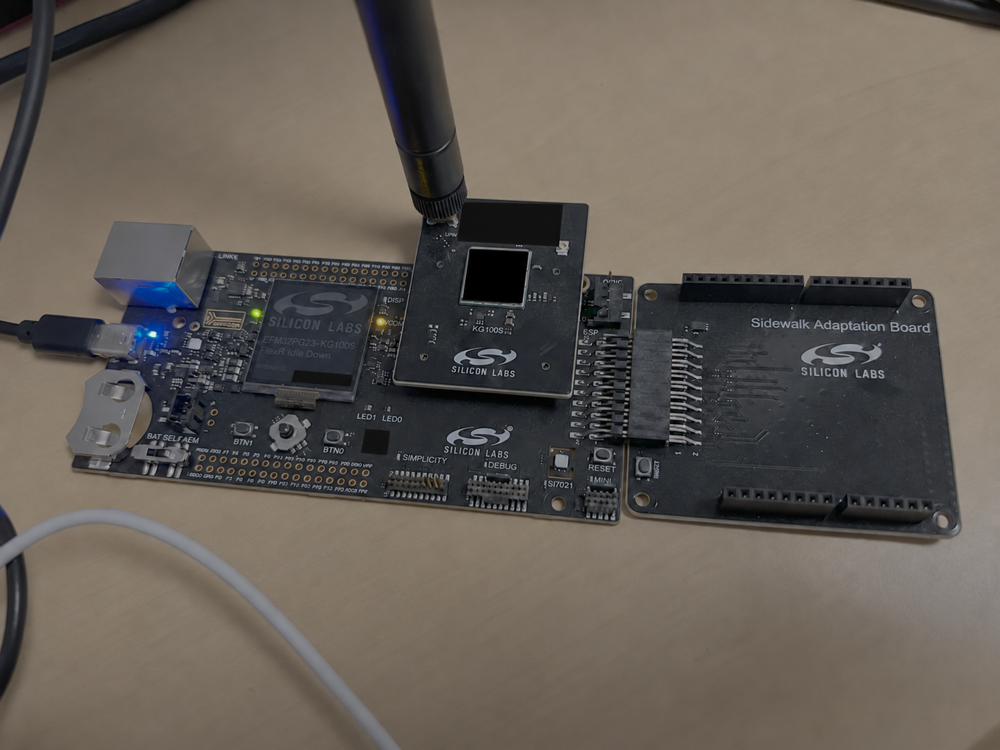

# OpenSidewalk

**Independent BLE and LoRaWAN firmware for the Silicon Labs KG100S development kit.**
BLE connection events, automatic OTAA joining, MCU temperature, two buttons,
and a ready-to-use TTN decoder.
Project code is licensed under **Apache-2.0**; third-party licenses are retained.



*Contributed hardware photo, identifiers redacted with an image-editing model.
The expansion adapter is pictured; this firmware uses the KG100S module's
integrated SX1262 radio. The photograph is not a pinout reference.*

## What it does

- LoRaWAN Class A, OTAA, **US915 FSB 2**, compatible with The Things Network.
- Starts joining about three seconds after boot/reset; failed joins back off
  for 60, 120, 240, 480, then 900 seconds, capped at fifteen minutes.
- Sends a ten-byte sample after joining, every five minutes, and after button
  changes (coalesced with a ten-second cooldown after a send attempt).
- Reports MCU die temperature in °C and °F, BTN0/BTN1 states and press counters.
- Stores credentials and monotonically reserved DevNonce in NVS; every reboot
  performs a fresh join. Storage errors and nonce exhaustion stop auto-joins.
- USB serial shell, larger ASCII boot banner, optional controller LCD nickname.
- Advertises as **OpenSidewalk** over BLE; each successful connection queues a
  `connected` event for TTN on FPort **3**, under the existing LoRaWAN identity.

OpenSidewalk is a replacement application built on Zephyr/LoRaMac-node. It does
not implement Amazon Sidewalk or connect to AWS. It is not affiliated with or
endorsed by Amazon, Silicon Labs, Semtech or The Things Network.

## Supported hardware

Tested with KG100S **BRD4332A**, EFR32BG21B010F1024IM32, on the **BRD4002A**
Wireless Pro Kit mainboard. The built-in SX1262 uses its 915 MHz antenna.
The pictured BRD8042A expansion adapter/external shield is not used.

## Connect an iPhone over BLE

1. Power the provisioned board with its 915 MHz antenna attached. It joins TTN
   automatically and advertises as **OpenSidewalk**.
2. Open a BLE scanner app such as **nRF Connect for Mobile** on your iPhone,
   allow Bluetooth access, scan, and tap **Connect** on **OpenSidewalk**.
   Use the BLE app to establish the connection; no custom phone app or pairing
   setup is required for this prototype.
3. In this TTN device's **Live data**, look for an FPort **3** uplink decoded as
   `event: "connected"`, with `ble_address`, `ble_address_type`, and `sequence`.
   Install the updated `decoder.js` as the device's custom uplink formatter.
4. Disconnect in the phone app to allow another device to connect. One BLE
   client is supported at a time. Reconnecting generates another event.

This version forwards **connection events**, not arbitrary Bluetooth streams.
The peer address identifies the connection; iPhones can rotate private BLE
addresses, so it is not a permanent phone ID. The peer's friendly name is not
automatically available. A generic BLE sensor that cannot initiate connections
would need a separate sensor-specific client implementation on the KG100S.

Events use unconfirmed LoRaWAN uplinks and are best effort. Up to eight events
wait in RAM while unjoined or while radio retries are pending. A full queue
drops the newest event and increments the drop counter. Reset discards queued
events. Attempts are spaced by 30 seconds; retries retain the head event.
`ble status` reports connection state, queued, locally sent and dropped counts.
Locally sent does not mean TTN acknowledged receipt.

FPort 3 is 11 bytes: schema **1**, event **1** (`connected`), big-endian
16-bit sequence, address type (**0** public / **1** random), six address bytes
in display order. Sequence starts at 1 each boot and wraps after 65535.

**Connect the correct antenna before powering a provisioned board.** It transmits
automatically. This is an experimental prototype, not a certified LoRaWAN product.
Only the US915 build is supplied; use it where that frequency plan is permitted.

Temperature is the MCU's internal die reading, not a calibrated ambient sensor.
The mainboard LCD is not wired to the KG100S application processor. A controller
nickname can display a short ASCII badge while retaining its normal logo/status.

## Flash the supplied firmware

Download a complete release bundle, including `LICENSE`, `NOTICE`,
`THIRD_PARTY_NOTICES.md` and `licenses/`, alongside the firmware.
The application image contains **no device credentials or saved session**.
Each user must provision their own TTN registration.

Back up your own existing application and USERDATA privately before replacing
factory firmware. Use [Silicon Labs Simplicity Commander](https://www.silabs.com/software-and-tools/simplicity-studio/simplicity-commander):

```sh
commander adapter list
commander flash firmware/opensidewalk-us915.hex --serialno YOUR_JLINK_SERIAL
```

The image starts at address zero. NVS occupies `0x000f8000–0x000fffff`;
application flash is `0x00000000–0x000f7fff`. USERDATA lies outside main flash.
Do not use `--masserase` for updates: it would erase credentials and the nonce
counter. An initial conversion from different firmware may have incompatible
settings at that location; inspect/erase only that storage partition if needed
before provisioning fresh credentials. Never resume an old credential profile
with a rolled-back nonce. No bootloader/security/debug-lock updates are included.

## Register and provision

In your TTN application, register an OTAA device with your own unique DevEUI,
JoinEUI and AppKey. Choose **US 902–928 MHz FSB 2**, LoRaWAN **1.0.4**, Regional
Parameters **RP002 1.0.3**, Class A. The gateway must use the same channel plan
and forward traffic to that TTN cluster. No TTN account or gateway is included.

Copy `credentials.example.json` to `credentials.json`, fill in your values, and
keep it private. Use a different identity/key for each device. Never provision
this board with another user's registration or include real keys in issues.

```sh
python3 -m venv .venv
. .venv/bin/activate
python -m pip install pyserial
python tools/console.py --port YOUR_SERIAL_PORT --provision credentials.json
```

Serial: **115200, 8N1**. On macOS the port generally starts `/dev/cu.usbmodem`;
on Linux `/dev/ttyACM`; on Windows `COM`. After provisioning, the firmware joins
automatically. Provision while unjoined; changing a joined profile requires a
reset and issuing the configuration command before the three-second autojoin.
The helper sets the sub-band before provisioning to avoid a join between steps.

```text
lw status
lw sensors
lw join
lw send
lw subband 2
lw provision <DevEUI-16-hex> <JoinEUI-16-hex> <AppKey-32-hex>
lw reboot
```

`lw join` is an optional manual attempt. `lw send` takes a fresh telemetry sample.
The shell and helper suppress key echo; keep terminal logs private regardless.
Manual sends bypass the button-event cooldown.

Optional LCD badge (controller nickname, independent of application flash):

```sh
commander adapter nick '((|)) KG100S' --serialno YOUR_JLINK_SERIAL
commander adapter reset --serialno YOUR_JLINK_SERIAL
```

The existing controller logo/status remains. To remove the badge, use
`commander adapter nick --clear --serialno YOUR_JLINK_SERIAL` and reset the
controller. The larger USB ASCII banner does not require this step.

## TTN payload decoder

Under this device's **Payload formatters → Uplink**, choose **Custom Javascript
formatter**, paste [`decoder.js`](decoder.js), and save. Set the formatter on
the device rather than changing other devices' application defaults.
FPort is **2**. Example: `01000309E70000020002` decodes to:

```json
{
  "schema_version": 1,
  "sequence": 3,
  "temperature_c": 25.35,
  "temperature_f": 77.63,
  "temperature_source": "mcu_die",
  "button_0_pressed": false,
  "button_1_pressed": false,
  "button_0_presses": 2,
  "button_1_presses": 2
}
```

| Bytes | Meaning (multi-byte values are big-endian) |
| --- | --- |
| 0 | Schema version 1 |
| 1–2 | Sample sequence, uint16 |
| 3–4 | Signed temperature ×100 °C; -32768 means unavailable |
| 5 | Bit 0: BTN0 pressed; bit 1: BTN1 pressed |
| 6–7 | BTN0 press count, uint16 |
| 8–9 | BTN1 press count, uint16 |

Press counts and sequence reset at boot and wrap after 65535. Counts preserve
short presses even if both buttons are released when sampled. Unavailable
temperature decodes to `null` with a warning. Fahrenheit is calculated in the
decoder and rounded to two decimals; resolution does not imply sensor accuracy.

## Build from source

Use Python 3.12 or newer, Git, Node.js, CMake/Ninja, and Zephyr SDK **1.0.1**
with the `arm-zephyr-eabi` toolchain. Host tests also need Clang.
Start in a parent directory whose path has no spaces:

```sh
mkdir opensidewalk-workspace
cd opensidewalk-workspace
git clone https://github.com/Kentucky-Open-Science/OpenSidewalk app
python3 -m venv .venv
. .venv/bin/activate
python -m pip install -r app/requirements-host.txt
west init -l app
west update
west blobs fetch hal_silabs
python -m pip install -r zephyr/scripts/requirements-base.txt
west zephyr-export
# Install Zephyr SDK 1.0.1 from its official release, or use west sdk install.
python app/tools/build.py --sdk /path/to/zephyr-sdk-1.0.1
python app/tests/run_tests.py
python app/tools/check_public_release.py
```

`west.yml` pins Zephyr v4.5.0 and imports only the needed module set, including
Mbed TLS / TF-PSA for Bluetooth controller support. Silicon Labs controller
and RAIL libraries are fetched with `west blobs fetch hal_silabs`. The build
script verifies the Zephyr commit and applies the two tracked patches, or checks
that they are already applied. It stages the application outside paths containing
spaces and produces `firmware/opensidewalk-us915.hex` and `.bin`.
See [validation](docs/VALIDATION.md), [RF-switch provenance](docs/RF_SWITCH_PROVENANCE.md)
and [third-party notices](THIRD_PARTY_NOTICES.md).

## Publishing and contributing

No factory images, credentials, memory dumps, TTN screenshots, gateway locations,
private serial logs, SDK installers or raw debugger ELF files belong in this repo.
The public photograph has its device identifiers redacted and ancillary metadata
removed. Release firmware includes only application address ranges, not NVS or
USERDATA. Keep the supplied license/notice files with redistributed binaries.

Project changes use Apache-2.0. Preserve third-party notices and document any
changes to upstream code. Report hardware model, version, region and redacted
logs when filing an issue; never provide keys or factory dumps.
